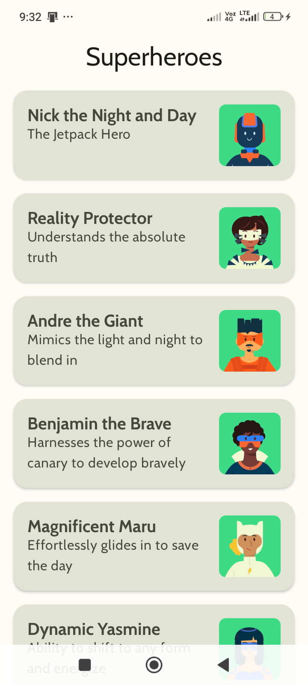
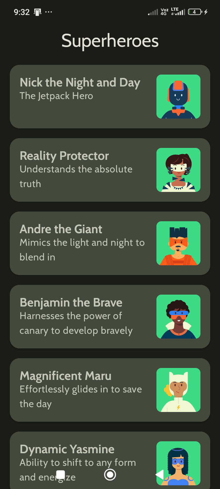

# Superheroes

Aplicación Android desarrollada con Kotlin y Jetpack Compose para practicar Material Design 3 mediante una lista de seis superhéroes. Implementa el [codelab oficial de Google: Práctica, compila una app de superhéroes](https://developer.android.com/codelabs/basic-android-kotlin-compose-practice-superheroes?hl=es-419).

[Repositorio público del proyecto](https://github.com/diegocalva04/Superheroes-Kotlin-JetpackCompose) · [Historial de commits](https://github.com/diegocalva04/Superheroes-Kotlin-JetpackCompose/commits/main/).

Se desarrolló progresivamente sobre la plantilla **Empty Activity creada por el usuario**, con commits auténticos en español. La solución de Google se consultó como referencia y como fuente de recursos; no se importó su historial Git.

## Resultado

| Tema claro | Tema oscuro |
| --- | --- |
|  |  |

Las capturas proceden de la aplicación ejecutada en un teléfono Xiaomi 23100RN82L con Android 15, API 35, pantalla de 720 × 1600 píxeles y densidad de 320 dpi. El [final de la lista](docs/evidencias/lista-final-claro.png) muestra a Dynamic Yasmine con su descripción completa. Las imágenes de Google se usaron para comparar, no como evidencias propias.

## Tecnologías y configuración

- Kotlin y complemento Compose 2.2.10; Kotlin integrado en Android Gradle Plugin.
- Jetpack Compose BOM 2026.02.01 y Material Design 3.
- Android Gradle Plugin 9.3.3 y Gradle Wrapper 9.5.0.
- JDK 25, conforme al criterio de JVM de la plantilla de Android Studio instalada.
- SDK mínimo **24**, SDK de compilación y destino **37**.
- Paquete y applicationId: **com.example.superheroes**.
- Pruebas: JUnit, AndroidX Test y Compose UI Test incluidos por la plantilla.

Se conservó el conjunto de herramientas de la plantilla disponible, en lugar de sustituirlo por el Gradle antiguo de la solución. No se agregaron bibliotecas para red, imágenes ni navegación.

## Estructura

```text
app/src/main/
├── AndroidManifest.xml
├── java/com/example/superheroes/
│   ├── MainActivity.kt
│   ├── HeroesScreen.kt
│   ├── model/
│   │   ├── Hero.kt
│   │   └── HeroesRepository.kt
│   └── ui/theme/
│       ├── Color.kt
│       ├── Shape.kt
│       ├── Theme.kt
│       └── Type.kt
└── res/
    ├── drawable/       # Seis héroes y capas del icono oficial
    ├── font/           # Cabin regular y negrita
    ├── mipmap-*/       # Iconos por densidad y adaptativos desde API 26
    └── values/         # Cadenas originales y tema de ventana
```

Las pruebas de interfaz están en `app/src/androidTest/`; la documentación, análisis y evidencias están en `docs/`.

## Datos y componentes

**Hero** es una clase de datos con tres identificadores enteros: `nameRes`, `descriptionRes` e `imageRes`. Las anotaciones `StringRes` y `DrawableRes` identifican el tipo de recurso tanto en los parámetros como en los campos.

**HeroesRepository.heroes** contiene, en el orden original, a Nick the Night and Day, Reality Protector, Andre the Giant, Benjamin the Brave, Magnificent Maru y Dynamic Yasmine. Sus nombres y descripciones ingleses se conservan exactamente en `strings.xml`; las ilustraciones provienen de `Image assets.zip` de Google.

**HeroListItem** utiliza Card, Row, Column, Spacer, Box, Image y Text. La tarjeta tiene elevación de 2 dp, radio de 16 dp, padding interno de 16 dp y contenido de altura mínima de 72 dp. La imagen ocupa 72 × 72 dp, tiene radio de 8 dp y está separada 16 dp del texto. El nombre utiliza `displaySmall` y la descripción `bodyLarge`. La altura puede crecer para que los textos largos no se recorten.

**HeroesList** representa la colección con `LazyColumn`, claves estables y márgenes de 16 dp horizontales y 8 dp verticales por elemento, como la solución de referencia. La lista compone los elementos de manera diferida y permite llegar al último héroe.

**SuperheroesApp** organiza la pantalla mediante `Scaffold`; entrega su padding interno a la lista. **TopAppBar** usa `CenterAlignedTopAppBar` con el título centrado y tipografía `displayLarge`, sin acciones adicionales.

## Material Design 3

`Color.kt` conserva los 29 roles de cada paleta oficial. `SuperheroesTheme` detecta el modo del sistema; `dynamicColor` está desactivado por defecto. Las tarjetas usan explícitamente `surfaceVariant` y `onSurfaceVariant` y la barra usa el fondo de la app para conservar la apariencia del codelab con Material 3 actual.

`Shape.kt` define radios small de 8 dp y medium/large de 16 dp. `Type.kt` configura Cabin Regular y Bold: `bodyLarge` de 16 sp, altura de línea de 24 sp y espaciado de 0,5 sp; `displayLarge` normal de 30 sp y `displayMedium`/`displaySmall` en negrita de 20 sp. Las fuentes están empaquetadas, sin descargas durante la ejecución.

## Pantalla completa

`Theme.kt` ejecuta `setUpEdgeToEdge` mediante `SideEffect`: decorado sin ajuste automático, barra de estado transparente y navegación transparente desde API 29. Para API 26–28 usa el velo claro y para API 24–25 el oscuro establecidos por el tutorial. Los iconos del sistema cambian de contraste según el tema. `Scaffold` administra los espacios de las barras para permitir leer el final de la lista.

El método conserva las APIs de color antiguas para compatibilidad con Android 7–14. Android 15 y versiones posteriores imponen parte del comportamiento de borde a borde. La ejecución y el contraste se comprobaron en API 35; las ramas API 24–28 se revisaron en código, sin afirmar que se ejecutaron allí.

## Ejecutar

1. Abrir esta carpeta como proyecto en Android Studio. El nombre del proyecto es **Superheroes**; la carpeta local puede conservar el nombre `App_Superheroes`.
2. Instalar SDK Platform 37 y utilizar un JDK 25 compatible con la configuración de JVM de Gradle de la plantilla.
3. Sincronizar Gradle y seleccionar un dispositivo Android con API 24 o superior.
4. Ejecutar el módulo `app`. En un teléfono, habilitar y aceptar la instalación por USB cuando el fabricante lo requiera.

Desde PowerShell, con Java configurado:

```powershell
.\gradlew.bat :app:assembleDebug
.\gradlew.bat :app:assembleDebugAndroidTest :app:lintDebug :app:testDebugUnitTest
.\gradlew.bat :app:connectedDebugAndroidTest
```

En Linux/macOS se puede utilizar `bash ./gradlew`. El APK de depuración se genera en `app/build/outputs/apk/debug/app-debug.apk`. No se versionan APK, contraseñas, keystores, `local.properties`, cachés ni archivos de Android Studio.

## Validación realizada

Se compilaron la aplicación y el APK de pruebas; `lintDebug` y `testDebugUnitTest` finalizaron correctamente. Se instaló e inició la aplicación en el teléfono de prueba y se ejecutó AndroidJUnitRunner: **6 pruebas instrumentadas aprobadas**, incluyendo cinco pruebas específicas de Compose y la prueba de contexto de la plantilla. La prueba unitaria de la plantilla es una comprobación básica y no sustituye las pruebas de interfaz.

Se verificaron el desplazamiento, los nombres y descripciones de los seis héroes, el título centrado, los dos temas y las paletas. Se capturaron las pantallas reales, se comprobó el final de la lista y se compararon colores, tipografía, imágenes y dimensiones con la referencia oficial. Los saltos de línea difieren con el ancho del dispositivo. Los vectores coinciden byte por byte con el ZIP oficial y las fuentes con la distribución oficial.

El informe completo, sus limitaciones y los resultados de publicación están en [docs/VALIDACION.md](docs/VALIDACION.md). El análisis de los seis apartados está en [docs/ANALISIS.md](docs/ANALISIS.md). No se ejecutaron pruebas en todos los niveles API ni en todos los fabricantes.

## Desarrollo e historial

El historial registra por separado la plantilla inicial, recursos oficiales, modelo, repositorio, colores, Cabin, formas, tarjetas, LazyColumn, barra superior, borde a borde, ajustes de compatibilidad, pruebas y documentación. Cada commit tiene título y cuerpo descriptivo en español, sin fechas artificiales ni commits vacíos. Véase [docs/HISTORIAL.md](docs/HISTORIAL.md) y el historial Git completo del repositorio.

## Referencias y licencias

- [Codelab oficial](https://developer.android.com/codelabs/basic-android-kotlin-compose-practice-superheroes?hl=es-419).
- [Solución oficial de Google, rama main](https://github.com/google-developer-training/basic-android-kotlin-compose-training-superheroes).
- [Cabin en Google Fonts](https://fonts.google.com/specimen/Cabin).
- Código y gráficos: [Apache License 2.0](LICENSE), con avisos de The Android Open Source Project.
- Fuentes: [SIL Open Font License](licenses/Cabin-OFL.txt) y [licencia de recursos oficial](ASSETS_LICENSE.txt).

Los detalles de procedencia, versiones de referencia y adaptaciones están en [NOTICE.md](NOTICE.md) y [docs/ANALISIS.md](docs/ANALISIS.md).
